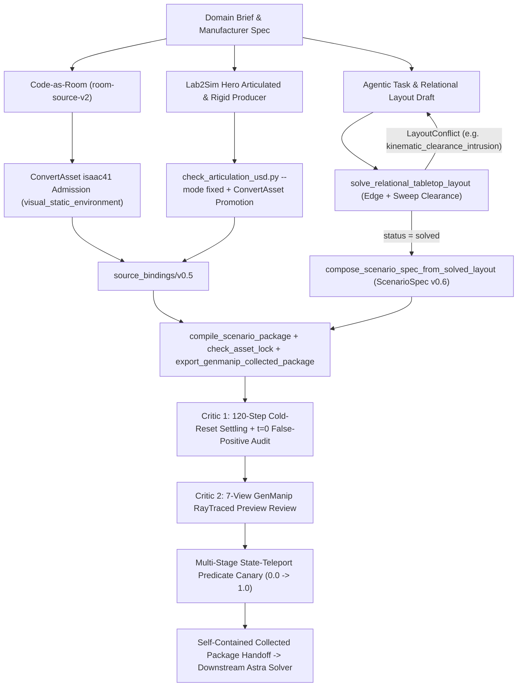

# Agentic Out-of-Domain Scene Factory Architecture

**Status**: Implemented (2026-11-12)
**Scope**: Cross-domain embodied evaluation scene generation (`specialty_coffee_bar`, `electronics_qa_station`, `modern_office_print_hub`) and alignment with NVIDIA's agentic simulation stack.

---

## 1. Motivation & Hard Boundaries

`scenario-forge` was designed as a **portable scenario package compiler** rather than a wet-lab-only asset repository or an episode runner. While earlier milestones heavily exercised `scientific_workbench` (titration burettes, drying ovens, GPU-PBD liquids), the underlying `ScenarioSpec` (`v0.6`), `ConvertAsset` handoff contracts, and `GenManip` collected-package exporter are domain-neutral.

This document defines the architecture that generalizes `scenario-forge` to arbitrary tabletop manipulation domains while strictly preserving `AGENTS.md` boundaries:

- **Pure package layers (`src/scenario_forge/`)** remain 100% free of simulator SDK (`isaacsim`, `omni.*`), OpenUSD (`pxr`), and LLM client imports.
- **Asset/USD normalization and runtime qualification** stay delegated to `ConvertAsset` (`visual_static_environment`, `static_support_object`, `articulated_object`, `rigid_object`, `dynamic_context_object`).
- **Agentic reasoning (LLM task planning, on-demand asset synthesis, visual Critic review)** lives in `skills/` (`skills/agentic-scene-factory/`, `skills/hunyuan-isaac-articulation-assets/`) and calls deterministic pure-Python solvers and CLI gates.
- **Robotic motion planning & trajectory rollouts** are explicitly separated from scene compilation and handed off via self-contained collected packages to downstream privileged-world solvers (`Astra` / *Embodied First Exam* §2.1).

---

## 2. Alignment Matrix vs. NVIDIA Agentic Simulation Stack

| Capability Layer | NVIDIA Reference Stack | Scenario Forge Out-of-Domain Factory | Parity & Differentiation |
|---|---|---|---|
| **Room Shell & Lighting** | **NVIDIA SAGE** / Omniverse procedural room generation | `Code-as-Room` (`room-source-v2` + `support_relations.json` audit) $\rightarrow$ `scenario-forge-generated-environment-intake/v0.2` $\rightarrow$ `ConvertAsset` `visual_static_environment` | Hash-locked room closures with explicit `Zone__Center_Open_Floor` workcell clearance and 0 floating background props. |
| **On-DemandSimReady Asset Synthesis** | **NVIDIA SimReady** + asset retrieval/generation | **Lab2Sim (`GEN-001..007`, `ART-001` fixed-base v2)**: datasheet-grounded spec (`E/F/D/U` dimension table) $\rightarrow$ `blender_procedural` / `hunyuan_part` USD authoring $\rightarrow$ non-convex cavity compound colliders (`USD-008`) $\rightarrow$ `ConvertAsset` `isaac41` runtime promotion | Exceeds generic convex-hull retrieval by producing manufacturer-grounded multi-DOF articulated machines with functional internal cavities (capsule chutes, 4-rail PCBA pin-nests, hollow printer drawer tunnels). |
| **Relational & Kinematic Layout Solving** | **NVIDIA Scenethesis** (VLM/LLM spatial constraint graph + optimization + critic refinement) | `relational_solver.py` (`relational-layout-spec/v0.1` $\rightarrow$ `relational-layout-result/v0.1`) + `spec_composer.py` | Deterministic seeded solver enforcing `0.10 m` table-edge margin (`LAY-001`), robot-facing yaw alignment, `stacked_on` container offsets, **and multi-DOF `kinematic_clearance_volumes`** (drawer pull-out & lever swing corridors), emitting structured `LayoutConflict` diagnostics for automated Critic repair. |
| **Dual-Critic Closed-Loop Verification** | **SAGE / Scenethesis** physics + VLM visual critics | **Critic 1 (Physics)**: 120-frame GenManip zero-action cold-reset settling (`< 5 mm` drift, `< 3°` tilt, zero fall-off) + `t=0` leaf-predicate false-positive audit. **Critic 2 (Visual)**: `render_genmanip_initial_preview.py` 7-view (`v0.3`) RayTraced review (`workspace_closeup`, `scene_overview`, `task_object_closeup`, 4 room views). | Separates deterministic geometric/kinematic conflict repair (pre-USD) from runtime physics settling and 7-view visual QA. |
| **Task & Evaluation Contract** | **NVIDIA Isaac Lab-Arena** (`Task` + sequential stage predicates + standardized env export) | `ScenarioSpec` `v0.6` (`articulation_joint_state_reached`, `relative_pose_reached` with part-frame `axis_alignment`, weighted `progress_rubric`) $\rightarrow$ `export_genmanip_collected_package` + **Multi-Stage State-Teleport Predicate Canary** (`0.0` $\rightarrow$ monotonic `k/K` $\rightarrow$ `1.0`) | Guarantees every compiled package has executable, non-vacuous GenManip `MetricsManager` stage gates before any policy or planner touches it. |

---

## 3. End-to-End Pipeline Architecture

---

## 4. Core Pure-Python Contracts

### 4.1 Domain Packs (`configs/domain_packs/<domain>/layout_constraints.yaml`)
Each new tabletop theme registers a lightweight domain pack specifying workspace defaults (`min_object_clearance_m`, `max_objects`) without modifying core schema validators:
- `configs/domain_packs/specialty_coffee_bar/layout_constraints.yaml`
- `configs/domain_packs/electronics_qa_station/layout_constraints.yaml`
- `configs/domain_packs/modern_office_print_hub/layout_constraints.yaml`

### 4.2 Multi-DOF Sweep-Aware Relational Solver (`src/scenario_forge/generation/layout/relational_solver.py`)
Accepts `relational-layout-spec/v0.1` containing:
- Table surface bounds (`x_range_m`, `y_range_m`, `surface_z_m`, `min_edge_clearance_m: 0.10`),
- Robot base XY (`[0.0, -1.02]`) defining the canonical robot-facing basis (`toward_robot`, `forward`, `left`, `right`),
- Object requests with `footprint_xy_m`, `region`, `facing`, `stacked_on` (`support_top_offset_z_m`), and **`kinematic_clearance_volumes`** (local XY bounding boxes swept by prismatic drawers or revolute levers),
- Directional/proximity relations (`left_of`, `right_of`, `in_front_of`, `behind`, `near`).

Both static footprints and `kinematic_clearance_volumes` must satisfy table-edge clearances and pairwise non-intrusion. When violated (for example, placing `a5_media_pack` at `[0.0, -0.200]` in front of `BrotherMFCL2820DW`, which clears the closed chassis `[-0.1095, +0.2895]` but blocks the `180 mm` `paper_cassette_pullout` corridor `[-0.292, -0.1095]`), the solver returns `status: "infeasible"` with structured `kinematic_clearance_intrusion` diagnostics and remediation hints.

### 4.3 Spec Composer (`src/scenario_forge/generation/spec_composer.py`)
`compose_scenario_spec_from_solved_layout(task_draft, solved_layout)` binds solved poses and centerline-span `tabletop_placement_exception` metadata into a strictly validated `ScenarioSpec` (`scenario-spec/v0.6`).

### 4.4 EBench GenManip Adapter & Preview Contract Refinements
Closed-loop runtime execution against Isaac Sim `4.1` + `GenManip` uncovered and hardened two adapter-layer contracts:
- **4-Level `ArticulationView` Joint Status Nesting (`src/scenario_forge/adapters/ebench/genmanip.py`)**: `ArticulationView.get_joints_state().positions.tolist()` returns shape `(1, num_dofs)`, so GenManip's `check_subgoal_finished_articulation` evaluates `status` as `list[list[list[list[float]]]]` (`"status": [[candidate]]`). Exporting 4 nested lists ensures `articulation_joint_state_reached` leaf clauses evaluate accurately in live `MetricsManager` ticks.
- **`Code-as-Room` `room-source-v2` Perimeter Wall Cutaways (`src/scenario_forge/adapters/ebench/preview.py`, `scripts/ebench/render_genmanip_initial_preview.py`)**: `room-source-v2` names perimeter wall Xforms `WallNorth`, `WallSouth_0..1`, `WallSide_0..1` in addition to underscore-separated `Wall_*`. Extending `_COMPLETE_WALL_ROOT_NAME` enables clean two-wall cutaway framing for `room_corner_a` / `room_corner_b` and doorway clearance for `room_entrance_eye_level` without hiding wall-mounted furniture (`WallShelf_*`).

---

## 5. Solvability Verification Split & Downstream `Astra` Handoff Contract

Per `AGENTS.md` Hard Boundaries, `scenario-forge` does **not** embed CuRobo IK search, privileged trajectory optimization, or policy rollouts. Instead, solvability verification is split cleanly across two repositories:

1. **Upstream (`scenario-forge` — Scene & Metric Solvability)**:
   - Proves every articulated joint cycles across its semantic bands under PhysX (`ConvertAsset` `articulation_runtime_qualification` + `benchtop_stability`),
   - Proves every task-interactive rigid object has non-convex cavity clearance (e.g., `CoffeeCapsule` inside `NespressoCreatistaPlus` chute, `PCBACarrierBoard` inside `IngunMA2111Fixture` 4-rail nest, `A5MediaPack` riding inside `BrotherMFCL2820DW` `PaperCassette` into the hollow `Base` tunnel),
   - Proves cold-reset stability (`120` zero-action steps), zero `t=0` metric false positives across all leaf predicates, and monotonic `0.0 -> 1.0` `MetricsManager` progression via `scripts/verify_genmanip_predicate_canary.py`.

2. **Downstream (`Astra` / *Embodied First Exam* §2.1 & Appendices C/G — Privileged Trajectory Synthesis)**:
   - Consumes the self-contained GenManip collected package (`package_manifest.json`, `assets/scene_usds/scenario_forge/<scenario_id>/scene.usda`, `tasks/config.yaml`, `episode_metadata.json`),
   - Reads full privileged world state (`scene.object_list`, `scene.articulation_list`, authoritative `named_frames` and `semantic_joints` in `scenario_forge_runtime_contract`),
   - Synthesizes collision-free bimanual `lift2` trajectories that drive the exact same `MetricsManager` from `0.0` to `1.0` to certify physical kinematic reachability and produce demonstration episodes.
