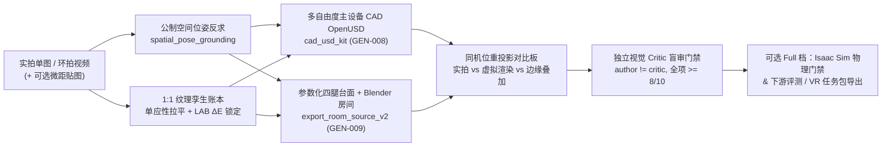

# Real-to-Sim 与 Agentic 场景资产工厂上手指南

本文面向拿到远端 GitHub 仓库（`https://github.com/jandan138/scenario-forge`）希望直接用**自己拍摄的照片/视频**或**文本需求**生产可交互 SimReady OpenUSD 资产与完整房间的开发者。

只需本地安装 **Python 3.10 + `usd-core` + Blender 4.4+** 并配合任一主流 Coding Agent（**Claude Code / Codex CLI / Cursor / OpenCode / Antigravity**），即可在**单仓自包含模式（Lite 档，无需先装 Isaac Sim）**下完整跑通 **1:1 纹理锁定 + 公制空间位姿反求 + 多自由度可动 CAD OpenUSD 建模 + 房间导出 + 同机位重投影对比 + 独立视觉盲审**闭环。

---

## 1. 方法原理总览：为什么不走传统 3DGS / 摄影测量网格？

传统单图/多视角网格重建（Photogrammetry / 3DGS 转 Mesh）容易出现遮挡背面破面、桌面小物体与台面粘连、抽屉/柜门无法拉开、内腔被封死为凸包等痛点，难以直接用于机器人操作仿真。

`scenario-forge` 采用 **「Agent 驱动的参数化 CAD OpenUSD + 1:1 实拍纹理色彩锁定 + 独立视觉 Critic 盲审闭环」**：



核心技术支柱（全部沉淀在本仓内，跨 Agent 宿主通用）：

1. **单图/视频公制空间位姿反求**（[`spatial_pose_grounding.py`](../../src/scenario_forge/adapters/spatial_pose_grounding.py)）：利用照片中的已知公制尺寸锚点（如标准机械键盘、27 寸显示器、工位桌高等），反求针孔相机焦距/俯仰角、桌面全部物体的公制 6DoF 位姿以及上下堆叠支撑关系图（Support DAG），杜绝悬空与穿模。
2. **1:1 纹理孪生账本与色差硬门禁**（[`texture_twin_ledger.py`](../../src/scenario_forge/adapters/texture_twin_ledger.py)，标准 [`GEN-010`](../standards/asset-generation.md)）：
   - 对平面屏幕 UI、铭牌、海报做**四点透视单应性拉平（Homography Rectification）**；
   - 对桌面木纹、地毯、吸音屏风、天花板等重复材质，支持直喂手机微距实拍图去高光无缝化，或基于原图局部采样生成高分辨率无缝 PBR 贴图后执行 **Reinhard CIE-LAB 色彩空间均值/方差锁定**，强制色差 $\Delta E^*_{ab} \le 12.0$。
3. **可交互多自由度 CAD OpenUSD 建模**（[`cad_usd_kit.py`](../../skills/hunyuan-isaac-articulation-assets/scripts/cad_usd_kit.py)，标准 [`GEN-008`](../standards/asset-generation.md)）：对需要拉开抽屉、翻开屏幕、旋钮按压或塞入物体的主设备，直接构建带真实板厚非凸内腔碰撞体（5 板抽屉盒 / 铰链门框）、BFS 关节树、阻尼刚度参数与 3D 矢量发光屏/丝印的干净 OpenUSD。
4. **内化 `room-source-v2` 房间导出与四腿支撑工作台**（[`export_room_source_v2.py`](../../skills/agentic-scene-factory/scripts/export_room_source_v2.py)，标准 [`GEN-009`](../standards/asset-generation.md)）：直接由 Blender 4.4 生成带完整墙地顶、照明与周边陈设的建筑级房间，自动推导支撑关系并导出标准 Z-up OpenUSD；主操作台面强制具备真实四腿落地支撑、裙边横梁与定制 PBR 贴图（严禁无腿悬空薄板）。
5. **作者-审稿人隔离的独立视觉盲审**（[`.claude/agents/visual-critic.md`](../../.claude/agents/visual-critic.md) / [`run_independent_visual_critic.py`](../../skills/agentic-scene-factory/scripts/run_independent_visual_critic.py)）：主建模 Agent 严禁自评放行，必须由独立上下文的视觉 Critic 对四视图、六视角房间图、贴图核对条与同机位重投影对比板逐项盲审打分（全维度 $\ge 8.0/10$ 方可放行）。

---

## 2. 5 分钟环境安装（双档模式）

### 档位一：Lite 轻量独立档（强烈推荐首次上手，单仓自包含）

无需安装重型 Isaac Sim 或额外外部仓库，在一台普通开发机 / Mac / Linux 工作站上即可完整生成：**1:1 贴图账本 + 可动主设备 OpenUSD + 四腿定制工作台 OpenUSD + 完整房间 OpenUSD + Cycles 渲染图 + 同机位重投影对比图 + 盲审验收报告**。

```bash
# 1. 克隆仓库并安装核心依赖与纯 Python OpenUSD SDK (usd-core)
git clone https://github.com/jandan138/scenario-forge.git
cd scenario-forge
python -m pip install -e ".[dev,usd]"

# 2. 准备 Blender 4.4+（用于房间构建、room-source-v2 导出及 Cycles AgX 影棚级渲染）
# 若 blender 已在系统 PATH 中可跳过；否则指定可执行文件路径：
export BLENDER_BIN=/path/to/blender-4.4.3-linux-x64/blender

# 3. 跑通仓内快速自检（约 15 秒，验证环境就绪）
make ci-check
```

随后在仓库根目录启动你常用的具备多模态看图能力的 Coding Agent 即可：
- **Claude Code**：在仓库根目录运行 `claude`（会自动加载根级 [`CLAUDE.md`](../../CLAUDE.md) 与 [`.claude/agents/visual-critic.md`](../../.claude/agents/visual-critic.md) 独立盲审子智能体）。
- **Codex CLI / OpenCode / Cursor / Antigravity**：在仓库根目录打开会话（会自动遵循 [`AGENTS.md`](../../AGENTS.md) 与 `skills/` 技能包）。

---

### 档位二：Full 完整物理仿真与评测包档（可选进阶）

如果你后续需要将产出的 OpenUSD 资产与房间进一步送入 **Isaac Sim 4.1+** 执行 PhysX 关节力控开合/内腔承重烟雾测试（`G4–G8`），或编译为下游机器人评测包 / VR 遥操作采集包，只需额外声明本地仿真工具路径：

```bash
export ISAAC_PYTHON=/path/to/isaacsim/python.sh
export CONVERT_ASSET_ROOT=/path/to/ConvertAsset
export GENMANIP_ROOT=/path/to/GenManip
```

> [!NOTE]
> `verify_ika_grade_hero_acceptance.py` 支持严格的证据分层（[`GEN-007`](../standards/asset-generation.md)）：在 Lite 档下传入 `--static-only` 会将报告状态诚实标记为 `PASS_STATIC_ONLY`（`physics_smoke: NOT_RUN_STATIC_ONLY`）；配置好 `ISAAC_PYTHON` 后去掉 `--static-only`，即可一键跑满全部 10 道动静态与视觉门禁。

---

## 3. 三套“复制即用”的 Agent 启动 Prompt 模板

把你拍好的照片（建议分辨率 $\ge 1920 \times 1080$，如有多角度环拍视频或桌面材质微距特写可一并放入）放到本地目录（例如 `inputs/my_desk/photo.jpg`，注意不要把私人大图提交进 git），然后直接复制对应模板发给 Agent：

### 模板 A（最常用）：单张实拍照片 / 视频 $\rightarrow$ 1:1 场景与可动资产重建 (`Real-to-Sim`)

```text
请先完整阅读以下规范与技能说明：
1. skills/agentic-scene-factory/SKILL.md
2. skills/hunyuan-isaac-articulation-assets/SKILL.md
3. docs/standards/asset-generation.md (GEN-008 / GEN-009 / GEN-010)
4. 参考样板配置：configs/real2sim_tasks_r1/real2sim_office_desk_riser_organize.yaml

我现在提供了一张真实拍摄的场景照片：inputs/my_desk/photo.jpg
（可选：以及局部材质微距照片 inputs/my_desk/macros/ / 环拍视频 inputs/my_desk/clip.mp4）。
输出产物请统一写入 external_artifacts/my_real2sim_run_01/。

请严格按本仓 Real-to-Sim 闭环全自动执行，不要跳步：
1. 【空间位姿反求】：识别照片中的已知公制尺寸物体作为尺度锚点，使用 src/scenario_forge/adapters/spatial_pose_grounding.py 反求相机内外参、台面尺寸、桌面各物体公制 6DoF 位姿与上下支撑 DAG，输出 pose_grounding_report.json。
2. 【1:1 纹理孪生账本】：盘点照片中所有关键可见材质表面（桌面、显示器屏幕、背景墙/隔断、地面、天花板、核心物件表面）：
   - 平面屏幕/标签做四点透视单应性拉平；
   - 木纹/织物/地毯等重复表面生成高分辨率无缝 PBR 贴图并用 Reinhard LAB 色彩锁定到原图裁剪块（保证 CIE76 ΔE <= 12.0）；
   - 运行 skills/agentic-scene-factory/scripts/build_texture_twin_ledger.py 与 verify_texture_patch_pairs.py 产出贴图对比条和校验报告。
3. 【可交互主设备与四腿工作台 CAD OpenUSD】：
   - 将画面中央需要交互的主设备（如带抽屉增高架/柜体、可开合笔记本/仪器等）用 skills/hunyuan-isaac-articulation-assets/scripts/cad_usd_kit.py 建模为带真实非凸内腔碰撞体、关节树与阻尼的 SimReady OpenUSD；
   - 按 GEN-009 为主桌子建立带真实四腿落地支撑、裙边横梁与 1:1 台面贴图的 OpenUSD（严禁无腿悬空薄板）；
   - 使用 skills/hunyuan-isaac-articulation-assets/scripts/blender_usd_studio_render.py 渲染 Cycles AgX 四视图，并运行 scripts/verify_ika_grade_hero_acceptance.py（若当前环境未配置 ISAAC_PYTHON 则加 --static-only，已配置则跑全量 10 道门禁）。
4. 【Blender 房间重建与内化导出】：编写房间构建脚本还原照片中的空间结构、照明与桌面陈设，运行 verify_and_render_room_pack.py 过门禁，并用 export_room_source_v2.py 导出标准 Z-up room-source-v2 OpenUSD。
5. 【同机位重投影与独立视觉盲审】：用反求出的相机参数在虚拟场景同机位渲染，运行 render_reprojection_comparison.py 合成 [实拍原图 | 虚拟渲染 | 50% 边缘叠加] 对比板；随后拉起独立上下文的 Visual Critic（严禁自评！）完成盲审打分并通过 run_independent_visual_critic.py 校验（全维度 >= 8.0/10，若不达标请按扣分项迭代修正直到全绿）。
```

---

### 模板 B：单件高精度多自由度家电 / 仪器 / 家具 OpenUSD 生产 (`GEN-008`)

当你只需要单独造一件高拟真、抽屉/柜门/旋钮可交互的 SimReady OpenUSD 资产时使用：

```text
请先完整阅读：
1. skills/hunyuan-isaac-articulation-assets/SKILL.md
2. skills/hunyuan-isaac-articulation-assets/references/ika-grade-acceptance-and-visual-critic.md
3. docs/standards/asset-generation.md (GEN-008)

请使用 skills/hunyuan-isaac-articulation-assets/scripts/cad_usd_kit.py 为我参数化建模一件 SimReady 多自由度可交互 OpenUSD 资产：
- 目标设备：<例如：双抽屉桌面收纳增高架 / 意式带蒸汽旋钮咖啡机 / 工业测试治具 / 微波炉>
- 外形公制包络（宽 x 深 x 高，单位米）：<例如：0.52 x 0.24 x 0.14>
- 需要的可动关节与交互内腔：<例如：左右两个 PhysicsPrismaticJoint 滑轨抽屉，抽屉内腔必须由 5 块薄板碰撞体围成真实凹腔以容纳放入的小物件，前面板带圆环拉手>
- 输出目录：external_artifacts/my_hero_asset_01/

要求：
1. 严禁单色方块堆砌，使用倒角外壳、真实把手几何、PBR 材质分层与 3D 矢量丝印/指示灯；
2. 渲染 Blender Cycles AgX 四视图（preview_iso / preview_front / preview_detail / preview_ui）；
3. 拉起独立 Visual Critic 盲审（全项 >= 8.0/10）并跑通 scripts/verify_ika_grade_hero_acceptance.py（无 Isaac Sim 时使用 --static-only，有 ISAAC_PYTHON 时跑全量 10 道门禁）。
```

---

### 模板 C：从文本需求生成全新主题房间 + 四腿定制工作台 + 多阶段场景 (`Scene Factory`)

当你没有实拍图、希望从零批量合成新领域室内场景（如咖啡吧台、电子质检车间、家庭书房、药房配液间等）时使用：

```text
请先完整阅读：
1. skills/agentic-scene-factory/SKILL.md
2. docs/standards/asset-generation.md (GEN-008 / GEN-009)
3. 参考样板配置：configs/out_of_domain_tasks_r4/specialty_coffee_bar_creatista_prep.yaml

请为我构建一套全新的高拟真室内场景与桌面资产包，输出到 external_artifacts/my_custom_scene_01/：
- 场景主题：<例如：现代精品手冲咖啡吧台 / 消费电子返修检测工位>
- 核心可动主设备：<例如：带可开合手柄仓与旋钮的浓缩咖啡机>
- 桌面交互小物件（3-5 件）：<例如：不锈钢拉花缸、陶瓷浓缩杯、咖啡粉罐>

请依次完成：
1. 生成主工作台与关键表面的高分辨率无缝 PBR 贴图，构建带真实四腿落地支撑、横梁裙边与防撞包边的定制工作台 OpenUSD（GEN-009）；
2. 用 cad_usd_kit.py 构建可交互主设备与精细桌面小物件 OpenUSD（GEN-008）；
3. 构建主题匹配的 Blender 建筑房间（保留中央机器人与操作台净空区），跑通 verify_and_render_room_pack.py 六视角门禁并导出 room-source-v2 标准 Z-up OpenUSD；
4. 使用关系布局求解器（scenario_forge.generation.layout_planner）规划无碰撞桌面排布，渲染全局场景图，并通过独立 Visual Critic 盲审（>= 8.0/10）。
```

---

## 4. 独立 CLI 工具链速查表

除了让 Agent 全自动串联调用外，你也可以单独运行以下脚本做分步调试与硬门禁验收：

| 阶段 | 脚本路径 | 典型命令示例 |
| :--- | :--- | :--- |
| **1:1 贴图账本构建** | [`skills/agentic-scene-factory/scripts/build_texture_twin_ledger.py`](../../skills/agentic-scene-factory/scripts/build_texture_twin_ledger.py) | `python skills/agentic-scene-factory/scripts/build_texture_twin_ledger.py --spec ledger_spec.yaml --out-dir outputs/ledger` |
| **贴图色差与盲审校验** | [`skills/agentic-scene-factory/scripts/verify_texture_patch_pairs.py`](../../skills/agentic-scene-factory/scripts/verify_texture_patch_pairs.py) | `python skills/agentic-scene-factory/scripts/verify_texture_patch_pairs.py --ledger-manifest outputs/ledger/ledger_manifest.json --max-delta-e 12.0` |
| **主设备 10 道门禁（Lite 静态档）** | [`scripts/verify_ika_grade_hero_acceptance.py`](../../scripts/verify_ika_grade_hero_acceptance.py) | `python scripts/verify_ika_grade_hero_acceptance.py --factory-root external_artifacts/my_run --evidence-root outputs/evidence --spec-config configs/my_task.yaml --critique-dir outputs/critiques --static-only` |
| **主设备 10 道门禁（Full 物理档）** | [`scripts/verify_ika_grade_hero_acceptance.py`](../../scripts/verify_ika_grade_hero_acceptance.py) | `ISAAC_PYTHON=/path/to/isaac/python python scripts/verify_ika_grade_hero_acceptance.py --factory-root external_artifacts/my_run --evidence-root outputs/evidence --spec-config configs/my_task.yaml --critique-dir outputs/critiques` |
| **Blender 房间六视角门禁** | [`skills/agentic-scene-factory/scripts/verify_and_render_room_pack.py`](../../skills/agentic-scene-factory/scripts/verify_and_render_room_pack.py) | `"$BLENDER_BIN" --background --python skills/agentic-scene-factory/scripts/verify_and_render_room_pack.py -- --source-script room_builder.py --out-dir outputs/room_views` |
| **导出 `room-source-v2` USD** | [`skills/agentic-scene-factory/scripts/export_room_source_v2.py`](../../skills/agentic-scene-factory/scripts/export_room_source_v2.py) | `"$BLENDER_BIN" --background --python skills/agentic-scene-factory/scripts/export_room_source_v2.py -- --run-dir outputs/room_run --source-script room_builder.py --delivery-dir outputs/room_v2 --background-asset-id my_room_v1 --source-image outputs/room_views/corner_ne.png --support-reviewer scene_author` |
| **同机位重投影三联对比板** | [`skills/agentic-scene-factory/scripts/render_reprojection_comparison.py`](../../skills/agentic-scene-factory/scripts/render_reprojection_comparison.py) | `python skills/agentic-scene-factory/scripts/render_reprojection_comparison.py --real-photo inputs/photo.jpg --virtual-render outputs/virtual_cam.png --out-image outputs/reprojection_board.png` |
| **独立视觉盲审契约核验** | [`skills/agentic-scene-factory/scripts/run_independent_visual_critic.py`](../../skills/agentic-scene-factory/scripts/run_independent_visual_critic.py) | `python skills/agentic-scene-factory/scripts/run_independent_visual_critic.py --report outputs/critiques/visual_critique_report.json --min-score 8.0 --verify-hashes` |

---

## 5. 延伸阅读与仓内参考样板

- **实拍办公工位 `Real-to-Sim` 完整配置样板**：[`configs/real2sim_tasks_r1/real2sim_office_desk_riser_organize.yaml`](../../configs/real2sim_tasks_r1/real2sim_office_desk_riser_organize.yaml)
- **三大跨域室内工坊（办公室 / SMT 车间 / 精品咖啡吧）样板**：[`configs/out_of_domain_tasks_r4/`](../../configs/out_of_domain_tasks_r4/)
- **场景与资产创作标准总表（`GEN-001` 至 `GEN-010`）**：[`docs/standards/README.md`](../standards/README.md)
- **Agentic 场景工厂与 `Real-to-Sim` 架构设计文档**：[`docs/design/agentic-out-of-domain-scene-factory.md`](../design/agentic-out-of-domain-scene-factory.md)
